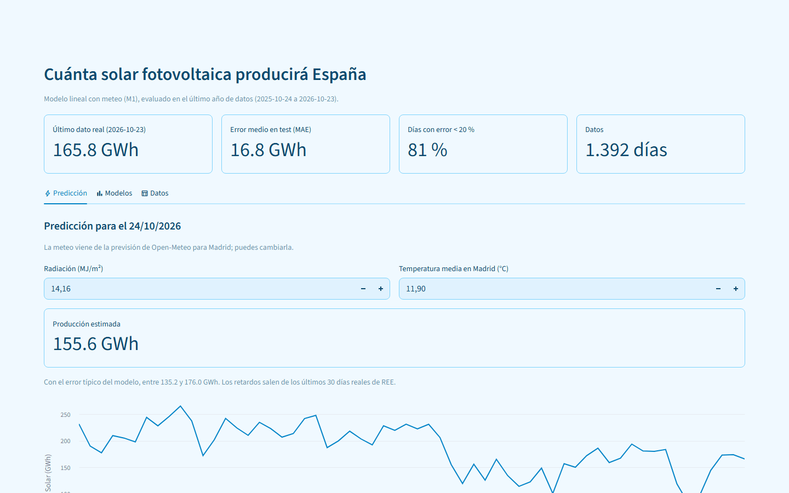
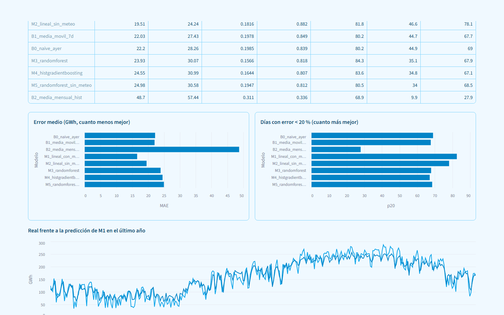

# Solar España — previsión de producción fotovoltaica

**Cuánta energía solar fotovoltaica producirá España mañana, con datos reales de REE y Open-Meteo.**

[](https://solar-espana.vercel.app) [](https://github.com/alvarodc093-pixel/Energia-Solar/actions/workflows/ci.yml) [](https://github.com/alvarodc093-pixel/Energia-Solar/actions/workflows/actualizar_datos.yml)   



## En resumen

- **Problema:** quien gestiona la red eléctrica necesita saber cuánta solar habrá mañana para planificar la reserva.
- **Datos:** producción solar diaria de REE desde 2023 y radiación y temperatura de Open-Meteo; se actualizan solos cada lunes.
- **Resultado:** el mejor modelo (lineal con meteo) acierta el 84,5 % y supera a los 3 baselines y a los modelos de árboles; la meteo aporta casi 3 puntos.
- **App:** predice el día siguiente con la previsión real de Open-Meteo y compara los modelos; se ejecuta en el navegador.

## Qué hay en cada archivo

```text
.
├── proyecto_solar.ipynb        # todo el análisis paso a paso, con gráficas
├── app.py                      # app en Streamlit para predecir el día siguiente
├── features.py                 # variables del modelo (las usan el entrenamiento y la app)
├── descargar_datos.py          # baja los datos de REE y Open-Meteo hasta ayer
├── datos.py                    # revisa la calidad y deja los datos limpios
├── entrenar_modelo.py          # entrena el M1 y lo guarda en models/modelo_solar.pkl
├── tests/                      # tests de las variables y de la descarga
├── index.html                  # demo web (stlite)
├── .github/workflows/          # tests en cada push y actualización semanal de datos
└── data/
    ├── solar_espana.csv        # un día por fila desde 2023-01-01
    ├── solar_espana_clean.csv  # lo mismo con columnas de fecha añadidas
    ├── solar_espana_notebook.csv  # instantánea fija que usa el notebook (hasta 2026-09-27)
    └── resultados_modelos.csv  # cómo lo hizo cada modelo en el notebook
```

## Los datos

- `solar_espana.csv`: columnas `fecha`, `solar_gwh`, `radiacion_MJm2`, `temp_media_Madrid`. Sin nulos, duplicados ni días sueltos.
- `solar_espana_clean.csv`: le añadí `dow`, `month`, `dayofmonth`, `dayofyear`, `year`, `weekend` a partir de la fecha.
- Para predecir usé: calendario + `dayofyear_sin/cos` + meteo del día + `lag1/2/3/7`, `roll7`, `roll30` (siempre con `shift(1)` para no copiar el futuro; hay un test que lo comprueba).
- Separé train y test por fecha: el test son los últimos 365 días, que el modelo no ha visto.
- Los datos se actualizan solos cada lunes con GitHub Actions: se descargan, se limpian, se reentrena el modelo y se pasan los tests. Ojo: REE revisa sus datos de los últimos días, así que un valor reciente puede cambiar un poco en la siguiente descarga.

Fuentes: [REE](https://apidatos.ree.es/es/datos/generacion/estructura-generacion) y [Open-Meteo](https://open-meteo.com) (histórico y previsión para Madrid, 40.41, -3.70).

## Qué hice en el notebook

El notebook analiza el periodo del 01/01/2023 al 27/09/2026 (1.366 días).

1. Planteé la pregunta: predecir `solar_gwh` de mañana.
2. Revisé los datos: 0 nulos, 0 duplicados, 0 huecos, 0 valores raros. Los extremos cuadraban (días nublados de invierno y veranos de 2026 con más placas), así que no borré nada.
3. Miré los datos con calma: serie en el tiempo + media de 30 días, radiación contra solar por año (corr 0.85), cajas por mes, temp contra solar, día de la semana (casi no afecta), histogramas, correlaciones, tabla año x mes, ratio solar/radiación (se ve que hay más capacidad cada año), y autocorrelación (lag-1: 0.92).
4. Separé train/test e hice 3 baselines: B0 lo de ayer, B1 media de 7 días, B2 media del mes de años anteriores.
5. Probé 5 modelos: M1 lineal con meteo, M2 lineal sin meteo, M3 RandomForest, M4 HistGradientBoosting, M5 RF sin meteo. Medí MAE, RMSE, MAPE, R², % acierto = 100·(1−MAPE) y % de días con error pequeño.
6. Saqué conclusiones y guardé `resultados_modelos.csv`.

## Cómo quedó cada modelo (test del 28/09/2025 al 27/09/2026)



| Modelo | MAE (GWh) | R² | % acierto |
|---|---|---|---|
| M1 lineal con meteo | 16.54 | 0.919 | 84.5 |
| M2 lineal sin meteo | 19.51 | 0.882 | 81.8 |
| B1 media móvil 7d | 22.03 | 0.849 | 80.2 |
| B0 lo de ayer | 22.20 | 0.839 | 80.2 |
| M3 RandomForest | 23.93 | 0.818 | 84.3 |
| M4 HistGradientBoosting | 24.55 | 0.807 | 83.6 |
| M5 RF sin meteo | 24.98 | 0.812 | 80.5 |
| B2 media mensual | 48.70 | 0.336 | 68.9 |

El detalle (RMSE, p10, p20) está en `data/resultados_modelos.csv`. Con los datos hasta el 23/10/2026, el M1 reentrenado da un MAE de 16.75 GWh en su último año, prácticamente lo mismo.

## Lo que saqué en claro

1. El mejor fue el M1, el lineal con meteo: MAE de 16.5 GWh y 84.5 % de acierto. Más de la mitad de los días clava con menos de un 10 % de error y 4 de cada 5 con menos de un 20 %.
2. La meteo importa mucho: sin ella el lineal baja de 84.5 % a 81.8 % y el RF de 84.3 % a 80.5 %.
3. Los árboles se quedaron atrás porque 2026 tiene más potencia instalada que no habían visto. El lineal sí tira para arriba gracias a `year` y a la relación radiación-solar.
4. Para negocio: con el M1 y la meteo prevista se puede planificar la reserva bastante bien.
5. Fallos que asumo: en el test uso la meteo observada como si fuera una previsión perfecta (en la app sí se usa la previsión real, que tendrá algo más de error), Madrid no es toda España, y hay que reentrenar a menudo porque cada año hay más placas (por eso se reentrena cada semana). Lo siguiente sería dar intervalos de predicción en vez de un solo número.

## La app

- Predice el día siguiente al último dato de REE. La radiación y la temperatura vienen de la previsión de Open-Meteo y se pueden cambiar a mano.
- Muestra el error del modelo en su último año, la comparativa de modelos del notebook y los datos recientes.
- Carga el modelo de `models/modelo_solar.pkl`; si la versión de scikit-learn no coincide (pasa en la demo web), lo reentrena al arrancar, que tarda menos de un segundo.

## Cómo probarlo

```bash
python -m venv .venv
.venv\Scripts\activate          # Windows (macOS/Linux: source .venv/bin/activate)
pip install -r requirements.txt

python descargar_datos.py       # baja REE y Open-Meteo hasta ayer (hace falta internet)
python datos.py                 # revisa y limpia
python entrenar_modelo.py       # entrena el M1
streamlit run app.py
pytest -q                       # tests
```

Los datos y el modelo ya vienen en el repo, así que para abrir la app basta con el último comando de Streamlit. Para volver a correr el notebook:

```bash
jupyter nbconvert --to notebook --execute proyecto_solar.ipynb --output proyecto_solar.ipynb
```

## Autor

Álvaro Domingo Cordón · [LinkedIn](https://www.linkedin.com/in/alvaro-domingo/) · [GitHub](https://github.com/alvarodc093-pixel)
