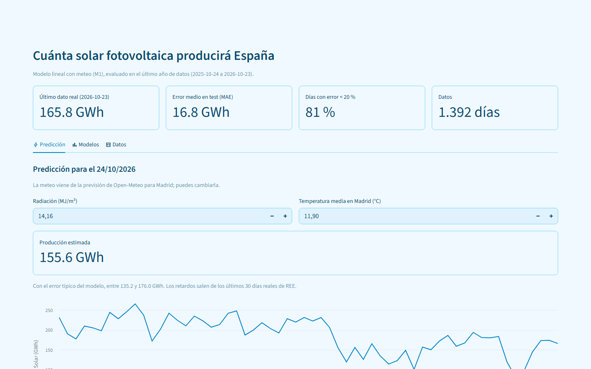
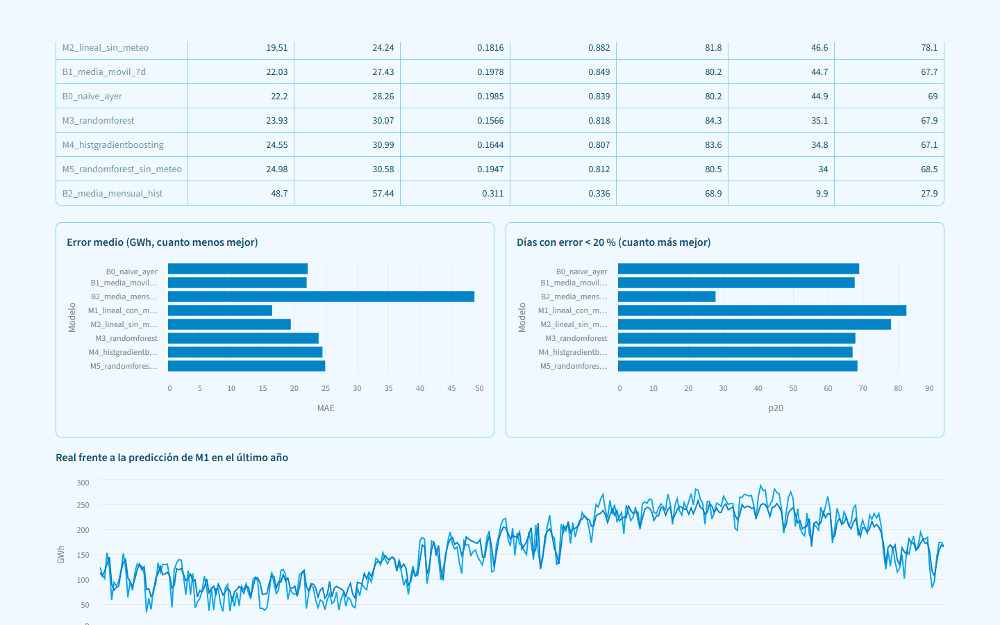

# Solar España — previsión de producción fotovoltaica

**Cuánta energía solar fotovoltaica producirá España mañana, con datos reales de REE y Open-Meteo.**

[](https://solar-espana.vercel.app) [](https://github.com/alvarodc093-pixel/Energia-Solar/actions/workflows/ci.yml) [](https://github.com/alvarodc093-pixel/Energia-Solar/actions/workflows/actualizar_datos.yml)   



## En resumen

- **Problema:** quien gestiona la red eléctrica necesita saber cuánta solar habrá mañana para planificar la reserva.
- **Datos:** producción solar diaria de REE desde 2023 y radiación y temperatura de Open-Meteo; se actualizan solos cada día.
- **Resultado:** el mejor modelo (lineal con meteo) acierta el 84,5 % y supera a los 3 baselines y a los modelos de árboles; la meteo aporta casi 3 puntos.
- **App:** predice el día siguiente con la previsión real de Open-Meteo y compara los modelos; se ejecuta en el navegador.

## Qué hay en cada archivo

```text
.
├── proyecto_solar.ipynb        # todo el análisis paso a paso, con gráficas
├── app.py                      # app en Streamlit para predecir el día siguiente
├── features.py                 # variables del modelo (las usan el entrenamiento y la app)
├── descargar_datos.py          # baja los datos de REE y Open-Meteo hasta ayer
├── datos.py                    # revisa la calidad y deja los datos limpios
├── entrenar_modelo.py          # entrena el M1 y lo guarda en models/modelo_solar.pkl
├── tests/                      # tests de las variables y de la descarga
├── index.html                  # demo web (stlite)
├── .github/workflows/          # tests en cada push y actualización diaria de datos
└── data/
    ├── solar_espana.csv        # un día por fila desde 2023-01-01
    ├── solar_espana_clean.csv  # lo mismo con columnas de fecha añadidas
    ├── solar_espana_notebook.csv  # instantánea fija que usa el notebook (hasta 2026-09-27)
    └── resultados_modelos.csv  # cómo lo hizo cada modelo en el notebook
```

## Los datos

- `solar_espana.csv`: columnas `fecha`, `solar_gwh`, `radiacion_MJm2` y `temp_media_Madrid`. Sin nulos, duplicados ni días que falten.
- `solar_espana_clean.csv`: añade `dow`, `month`, `dayofmonth`, `dayofyear`, `year` y `weekend` a partir de la fecha.
- **Variables del modelo de la app** ([features.py](features.py)): meteorología del día, día de la semana, estacionalidad con `dayofyear_sin/cos`, una tendencia continua en años, retardos de la producción (`lag1/2/3/7`, `roll7`, `roll30`) y `rad_x_ratio30`, la radiación del día multiplicada por los GWh por MJ/m² de los 30 días anteriores, que recoge el aumento de potencia instalada. No se usan `month`, `dayofmonth`, `dayofyear` ni `year` como números: en un modelo lineal son casi colineales y hacían saltar la predicción en cada cambio de mes y de año. Los retardos se calculan con `shift(1)` para no usar información del futuro, y los tests comprueban eso y que la serie no tenga días sueltos.
- **Partición por fecha:** el test son los últimos 365 días, que el modelo no ve al entrenar.
- **Actualización automática:** cada día un workflow de GitHub Actions descarga los datos nuevos, los valida (si hay huecos, nulos o valores imposibles se para sin guardar nada), reentrena el modelo y pasa los tests. REE revisa sus datos de los últimos días, así que un valor reciente puede cambiar ligeramente en la siguiente descarga.

Fuentes: [REE](https://apidatos.ree.es/es/datos/generacion/estructura-generacion) y [Open-Meteo](https://open-meteo.com) (histórico y previsión para Madrid, 40,41 / -3,70).

## El análisis

El [notebook](proyecto_solar.ipynb) analiza del 01/01/2023 al 27/09/2026 (1.366 días):

1. **Pregunta:** predecir `solar_gwh` del día siguiente.
2. **Calidad de datos:** 0 nulos, 0 duplicados, 0 huecos y ningún valor anómalo. Los extremos tienen explicación (días nublados de invierno y veranos de 2026 con más potencia instalada), así que no se elimina nada.
3. **EDA:** serie temporal con media de 30 días, radiación frente a producción por año (correlación 0,85), distribución por mes, temperatura, día de la semana (casi no influye), correlaciones, tabla año × mes, ratio producción/radiación (crece cada año con la potencia instalada) y autocorrelación (0,92 a un día).
4. **Baselines:** B0, el valor de ayer; B1, la media de 7 días; B2, la media del mismo mes en años anteriores.
5. **Modelos:** M1 lineal con meteorología, M2 lineal sin meteorología, M3 Random Forest, M4 HistGradientBoosting y M5 Random Forest sin meteorología. Métricas: MAE, RMSE, MAPE, R², % de acierto = 100·(1 − MAPE) y % de días con error pequeño.
6. **Conclusiones** y resultados guardados en `resultados_modelos.csv`.

## Resultados (test del 28/09/2025 al 27/09/2026)



| Modelo | MAE (GWh) | R² | % acierto |
|---|---|---|---|
| M1 lineal con meteo | 16,54 | 0,919 | 84,5 |
| M2 lineal sin meteo | 19,51 | 0,882 | 81,8 |
| B1 media móvil 7 días | 22,03 | 0,849 | 80,2 |
| B0 valor de ayer | 22,20 | 0,839 | 80,2 |
| M3 Random Forest | 23,93 | 0,818 | 84,3 |
| M4 HistGradientBoosting | 24,55 | 0,807 | 83,6 |
| M5 RF sin meteo | 24,98 | 0,812 | 80,5 |
| B2 media mensual | 48,70 | 0,336 | 68,9 |

El detalle (RMSE y % de días con error menor del 10 % y del 20 %) está en `data/resultados_modelos.csv`. La tabla es la del notebook, con las variables originales. El modelo de la app usa las variables nuevas descritas arriba: sobre el mismo periodo de test baja el MAE de 16,54 a 15,57 GWh (WAPE 9,7 %), y reentrenado con datos hasta el 08/11/2026 da un MAE de 15,68 GWh en su último año, frente a 22,32 de la persistencia.

## Conclusiones

1. **El mejor modelo es el M1, lineal con meteorología:** MAE de 16,5 GWh y 84,5 % de acierto. Más de la mitad de los días el error es menor del 10 %, y 4 de cada 5 días, menor del 20 %.
2. **La meteorología importa:** sin ella, el lineal baja del 84,5 % al 81,8 % y el Random Forest del 84,3 % al 80,5 %.
3. **Los árboles se quedan atrás** porque en 2026 hay más potencia instalada que en cualquier dato de entrenamiento, y un árbol no extrapola. El lineal sí sigue la tendencia gracias a la tendencia temporal y a la relación entre radiación y producción.
4. **Para negocio:** con el M1 y la previsión meteorológica se puede planificar la reserva del día siguiente con un error típico de unos 16 GWh.

## Limitaciones

- En el test se usa la meteorología observada como si fuera una previsión perfecta. La app usa la previsión real, que añade algo de error.
- La meteorología es la de Madrid, que no representa a toda España.
- La potencia instalada crece cada año, así que el modelo necesita reentrenarse a menudo (por eso se reentrena cada día).
- El modelo da un único valor. El siguiente paso sería dar intervalos de predicción.

## La app

- Predice el día siguiente al último dato de REE. La radiación y la temperatura vienen de la previsión de Open-Meteo y se pueden cambiar a mano.
- Muestra el error del modelo en su último año, la comparativa de modelos del notebook y los datos recientes.
- Carga el modelo de `models/modelo_solar.pkl`. Si la versión de scikit-learn no coincide (pasa en la demo web), lo reentrena al arrancar en menos de un segundo.

## Cómo probarlo

```bash
python -m venv .venv
.venv\Scripts\activate          # Windows (macOS/Linux: source .venv/bin/activate)
pip install -r requirements.txt

python descargar_datos.py       # baja REE y Open-Meteo hasta ayer (hace falta internet)
python datos.py                 # revisa y limpia
python entrenar_modelo.py       # entrena el M1
streamlit run app.py
pytest -q                       # tests
```

Los datos y el modelo ya vienen en el repo, así que para abrir la app basta con el último comando de Streamlit. Para volver a correr el notebook:

```bash
jupyter nbconvert --to notebook --execute proyecto_solar.ipynb --output proyecto_solar.ipynb
```

## English summary

Daily forecast of Spain's solar photovoltaic output for the next day, using REE generation data and Open-Meteo weather data. Five models are compared against three baselines on the last 365 days, which are held out by date. The best one, a linear model with weather features, reaches 84.5 % accuracy (MAE of 16.5 GWh, R² 0.92). Weather adds almost 3 points, and tree models fall behind because installed capacity keeps growing. Data and model refresh every week through GitHub Actions, and the Streamlit app predicts the next day with the real weather forecast.

## Autor

Álvaro Domingo Cordón · [LinkedIn](https://www.linkedin.com/in/alvaro-domingo/) · [GitHub](https://github.com/alvarodc093-pixel)
